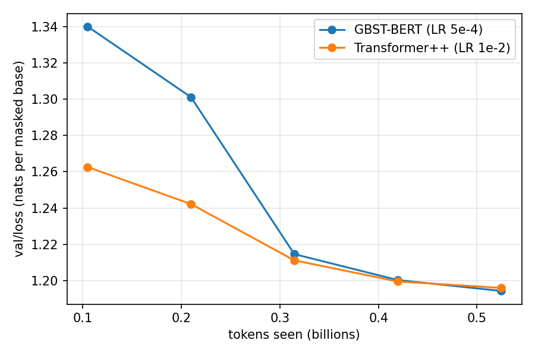
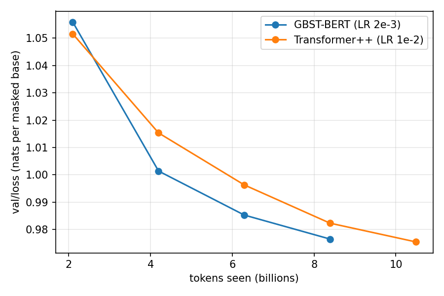
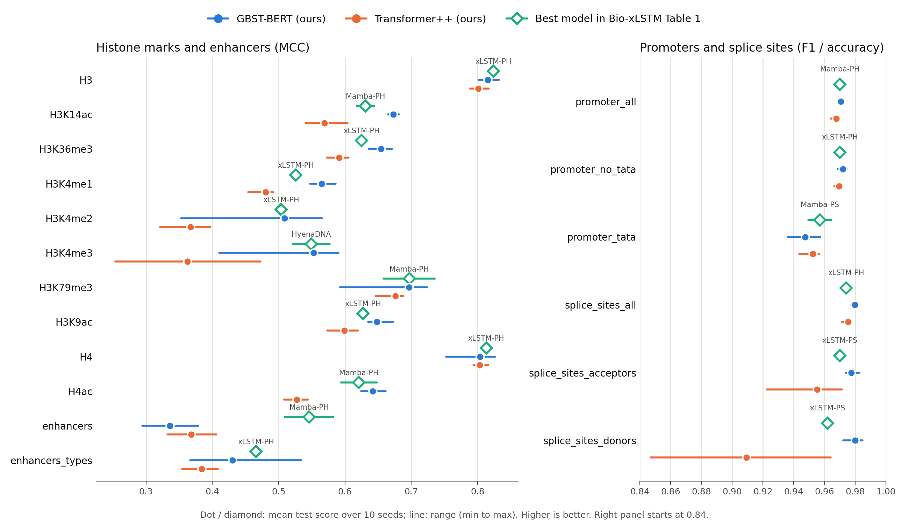
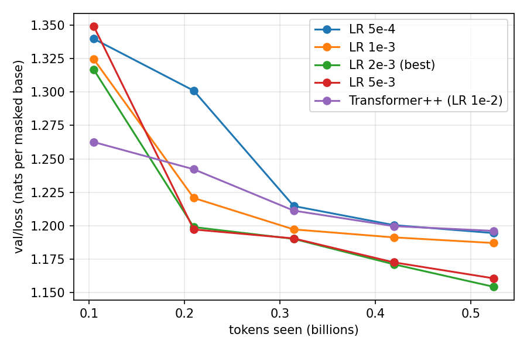
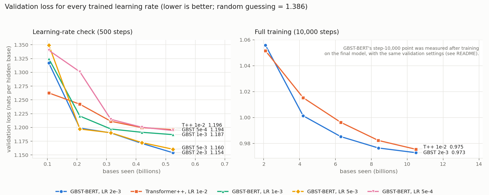

# GBST + BERT (ChaRNABERT-style) on DNA-xLSTM

This branch (`charna-gbst`) adds a ChaRNABERT-style model to the DNA-xLSTM code base: a
**Gradient-Based Subword Tokenizer (GBST)** in front of a **bidirectional BERT-style Transformer
encoder**, built as described in ChaRNABERT §3 and trained with masked language modelling (MLM)
or, optionally, UL2 masking (ChaRNABERT §4.1). It is pretrained on hg38 with the short-context
DNA-xLSTM protocol and evaluated on the 18-task **Nucleotide Transformer (NT) benchmark**, so the
results are directly comparable with the Bio-xLSTM paper.

**Quick links**

| | |
|---|---|
| Everything in one folder (code, data, results) | [`charna_project/`](charna_project/) |
| **Trained models** (checkpoints, resumable) | [`charna_project/models/`](charna_project/models/README.md) |
| **Moving to a new server** (setup, continue training) | [`docs/MOVING_TO_NEW_SERVER.md`](docs/MOVING_TO_NEW_SERVER.md) |
| **Every run, one page each** (settings, command, results, files) and the project log | [`charna_project/runs/`](charna_project/runs/README.md) |
| Results of the runs | [`charna_project/results/`](charna_project/results/) |
| **NT benchmark results** (table, figure) | [`charna_project/results/downstream/`](charna_project/results/downstream/nt_comparison.md) |
| Fine-tuned NT models (360 + 24 checkpoints) | GitHub release [`nt-finetuned-models`](https://github.com/OMAR622-ai/dna-xlstm-charna/releases/tag/nt-finetuned-models) |
| Data (interval list, hg38 sample, download script) | [`charna_project/datasets/`](charna_project/datasets/), [`scripts_charna/download_data.sh`](scripts_charna/download_data.sh) |
| **Notebook: every step explained, run and checked** (data, model, pretraining, final test, GBST analysis, 18 prediction tasks, all tables and figures; runs on student07) | [`notebooks/GBST_BERT_full_pipeline.ipynb`](notebooks/GBST_BERT_full_pipeline.ipynb) |
| **The whole model in one file** (clean, only needs PyTorch; loads the trained model; `python gbst_bert.py --test`) | [`gbst_bert.py`](gbst_bert.py) |
| Model code (GBST + encoder) | [`models/charna/`](models/charna/) |
| **Explainer video (88 s, MP4)** | [`docs/video/explainer.mp4`](docs/video/explainer.mp4) (made with `scripts_charna/make_explainer_video.py`) |
| **Poster (A0 PDF)** | [`docs/poster/POSTER.pdf`](docs/poster/POSTER.pdf) (preview: [PNG](docs/poster/POSTER_preview.png)) |
| Report (PDF) | [`docs/report/REPORT.pdf`](docs/report/REPORT.pdf) |
| Beginner's explanation of the whole project | [`docs/EXPLAINED.md`](docs/EXPLAINED.md) |
| 50 questions and short answers | [`docs/QA_50.md`](docs/QA_50.md) |
| Original DNA-xLSTM README (installation, data, other models) | [`README_DNA_XLSTM.md`](README_DNA_XLSTM.md) |

Papers used (all hyperparameters below cite one of them):

| Short name | Paper |
|---|---|
| Bio-xLSTM | Schmidinger et al., *Bio-xLSTM: Generative modeling, representation and in-context learning of biological and chemical sequences*, arXiv:2411.04165 |
| ChaRNABERT | Morales-Pastor et al., *Character-level Tokenizations as Powerful Inductive Biases for RNA Foundational Models*, arXiv:2411.11808 |
| Charformer | Tay et al., *Charformer: Fast Character Transformers via Gradient-based Subword Tokenization*, arXiv:2106.12672 |
| UL2 | Tay et al., *UL2: Unifying Language Learning Paradigms*, arXiv:2205.05131 |

## Status (17 October 2026)

| Step | State |
|---|---|
| Model, UL2, configs, tests | done, 23 unit tests pass |
| Overfit one batch | done: loss < 0.05 after 164 steps (MLM) and 230 steps (UL2) |
| Smoke run (50M tokens, both models) | done, see [Smoke run](#smoke-run-50m-tokens) |
| Small experiment (≈0.5B tokens, both models, accuracy + loss curve) | **done** (4 Oct 2026, 22:05 CEST), see [Small experiment](#small-experiment-05b-tokens): both ≈44% masked-base accuracy, GBST-BERT very slightly ahead |
| Learning-rate check (GBST-BERT, 1e-3 / 2e-3 / 5e-3, 500 steps each) | **done** (5 Oct 2026, 05:00): **2e-3 best**, see [Learning-rate check](#learning-rate-check) |
| Full pretraining (10.5B tokens, both models) | **done** (6 Oct 2026, 23:27). See [Final results](#final-results) |
| NT benchmark (18 tasks, 10 seeds, both models) | **done** (17 Oct 2026, 12:10). See [Downstream results](#downstream-results-nt-benchmark) |
| Ablations (d_s, MLM vs UL2, RC aug, GBST vs embedding) | not started |

Final results: [pretraining](#final-results) and [NT benchmark](#downstream-results-nt-benchmark).
Numbers from smoke runs and the small experiment are labelled as such. All result files are in
[`charna_project/results/`](charna_project/results/); the data that fits in git is in
[`charna_project/datasets/`](charna_project/datasets/).

## What was added

All changes are additive: existing models and default behaviour are unchanged
(`mlm_strategy` defaults to `"mlm"`, new registry names only).

| File | Purpose |
|---|---|
| `models/charna/gbst.py` | GBST tokenizer (candidate blocks, scoring, calibration, optional downsampling) |
| `models/charna/modeling_charna.py` | Encoder (RoPE, SwiGLU, QKNorm, LayerNorm), MLM head, reverse-complement helpers |
| `models/charna/configuration_charna.py` | `CharnaConfig` (defaults = 2M model) |
| `configs/model/charna.yaml` | Hydra model config (`model=charna`) |
| `src/dataloaders/utils/ul2.py` | UL2 masking (ChaRNABERT §4.1) adapted to in-place `[MASK]` |
| `src/dataloaders/datasets/hg38_dataset.py`, `src/dataloaders/genomics.py` | `mlm_strategy: mlm \| ul2` switch (train split only); fix: genome file reopened per DataLoader worker |
| `src/dataloaders/datasets/nucleotide_transformer_dataset.py` | Fix: load each NT task's own parquet file (see [Known issues](#known-issues)) |
| `src/models/sequence/dna_embedding.py` | Downstream wrappers `DNAEmbeddingModelCharna` and `DNAEmbeddingModelTransformer` |
| `src/utils/registry.py` | `charna_lm`, `dna_embedding_charna`, `dna_embedding_llama`, `metrics_csv` |
| `src/callbacks/metrics_csv.py` | Writes validation/test metrics to `metrics.csv` (wandb is off on our server) |
| `scripts_pretrain/run_pretrain_charna.sh` | Pretraining (GBST + BERT or Transformer++, same protocol) |
| `scripts_downstream/run_nucleotide_charna.sh` | NT benchmark fine-tuning |
| `scripts_charna/summarize_nt.py` | NT results table (best grid point per task, mean ± std and range) |
| `scripts_charna/evaluate_mlm.py` | Masked-base accuracy and loss of pretrained models on held-out sequences |
| `scripts_charna/train_charna.py` | Launcher for GPUs without mamba_ssm / flash_attn (see [Hardware](#hardware-and-environment)) |
| `scripts_charna/overfit_one_batch.py`, `scripts_charna/smoke_run.sh` | Sanity checks |
| `tests/test_charna.py`, `tests/test_downstream.py` | Unit tests |
| `scripts_charna/download_data.sh`, `scripts_charna/make_hg38_sample.py` | Download and check the full data; build the small hg38 sample |
| `scripts_charna/collect_results.sh` | Copy run results (metrics, configs, summaries) into `charna_project/results/` |
| `charna_project/` | The whole project in one folder: copies of all files above, a patch of the changes to existing files, the data that fits in git (`datasets/`) and the run results (`results/`) |

## Model

**GBST** (ChaRNABERT §3.2, Eq. 1–7; Charformer §2):

1. Character embedding, then a depthwise 1D convolution with kernel size M (Eq. 1) followed by
   a pointwise d × d projection. Eq. 1 names only the depthwise convolution, but Table 9 counts
   the GBST convolution as d_model × M + d_model² parameters, which is a depthwise-separable
   convolution; we follow the table (`gbst_pointwise_conv=true`).
2. For every position *i*, candidate blocks of size *b* = 1..M with all offsets (the blocks of
   size *b* that contain *i*), each represented by sum pooling: K = M(M+1)/2 candidates.
3. A linear scorer (no bias) gives one score per candidate; softmax over the K candidates.
4. Score calibration P̃ = softmax(PPᵀ)P (ChaRNABERT Eq. 6).
5. Output: score-weighted sum of the candidates, one latent per nucleotide.
6. Optional Charformer mean-pool downsampling by d_s. ChaRNABERT removes downsampling
   ("We also differ from the original implementation in the removal of the downsampling
   procedure", §3.2), so the default is **d_s = 1** (single-nucleotide resolution).

**Encoder** (ChaRNABERT §3.3): pre-norm Transformer encoder blocks with RoPE, SwiGLU, QKNorm and
LayerNorm, bidirectional attention (PyTorch SDPA), MLM head without bias.

**Size**: the shape of Bio-xLSTM's DNA-Transformer++-2M (Table A3): d_model 256, 4 blocks,
8 heads, up-projection 1.25:1 (SwiGLU hidden size 320), no norm/linear biases. Parameter count
2,107,392 (Transformer++-2M with the same shape: 2,036,992, 3.5% fewer); the difference is the
GBST (70,144 parameters). The ChaRNABERT sizes (8M to 650M, Table 1) are for RNA; the project
uses the 2M size so that results compare with DNA-xLSTM-2M.

| GBST setting | Value | Source |
|---|---|---|
| Max block size M | 4 | **Not stated in ChaRNABERT.** Charformer illustrates M = 4 (§2.1, Fig. 2); chosen as default |
| Offsets | on | ChaRNABERT §3.2 (Eq. 3 uses offsets o) |
| Block pooling | sum | ChaRNABERT §3.2 |
| Conv kernel size | M | ChaRNABERT §3.2 ("convolution of kernel size equal to the maximum block size") |
| Pointwise d × d after the depthwise conv | on | ChaRNABERT Table 9 (d_model × M + d_model²) |
| Score calibration | on | ChaRNABERT Eq. 6 |
| Downsampling d_s | 1 | ChaRNABERT §3.2 (downsampling removed) |

**Paper vs. this implementation.** Everything in ChaRNABERT §3 is implemented as written, with
these exceptions:

| ChaRNABERT | Here | Why |
|---|---|---|
| FlashAttention 2 (§3.3) | PyTorch scaled-dot-product attention | FlashAttention 2 needs Ampere GPUs; ours are GTX 1080 Ti. The attention computed is the same |
| bf16, DeepSpeed ZeRO (§4.3) | fp32, Lightning DDP | no bf16 on GTX 1080 Ti |
| Eq. 3 offsets written as X[i+o : i+o+b] | blocks that contain position i, X[i−o : i−o+b] | the literal index gives position i blocks that do not contain it; the text ("starting from position 0 and position 1", reading frames) describes shifted segmentations, which is what we implement (see `models/charna/gbst.py`) |
| Eq. 9 written as σ(xW₁) ⊙ swish(xW₂) | standard SwiGLU, swish(xW₁) ⊙ xW₂ | the text cites SwiGLU (Shazeer, 2020), which is the standard form; Eq. 9 as printed is a different function |
| Max block size M | 4 | not stated in ChaRNABERT (see table above) |
| Norm biases | none | not stated in ChaRNABERT; Bio-xLSTM Table A3 uses no biases |
| RNA data, context 2k–8k, bf16 (§4–5) | hg38, context 1k, fp32 | the project follows the DNA-xLSTM pretraining protocol so the NT results compare with Bio-xLSTM |
| BEACON downstream tasks, class-token heads (§6) | NT benchmark, mean pooling + linear head | same reason |

## Training protocol

Pretraining on hg38 follows the short-context DNA-xLSTM protocol (Bio-xLSTM App. C.5,
Tables A3 and A4), identical for GBST + BERT and the Transformer++-2M baseline:

| Setting | Value | Source |
|---|---|---|
| Context length | 1,024 | Table A3 |
| Tokens per step | 2²⁰ (1,024 sequences × 1,024) | App. C.5 |
| Update steps | 10,000 (≈10.5B tokens) | Table A4 |
| Optimizer | AdamW, β = (0.9, 0.95), weight decay 0.1 | Table A4 |
| Learning rate | GBST + BERT: 5e-4; Transformer++-2M: 1e-2 | GBST + BERT: ChaRNABERT Table 2 (best value for the 5M model, with GBST and with EM); Transformer++: Bio-xLSTM Table A3 (sweep 6e-3, 8e-3, **1e-2**) |
| Schedule | cosine decay, 1,000 warmup steps, minimum LR 1e-4 | Table A4 (repo `hg38.yaml`: `warmup_t = 0.1 × max_steps`, `lr_min = 1e-4`). ChaRNABERT gives no schedule |
| Dropout | 0 | Table A4 |
| Gradient clipping | 1.0 | repo `run_pretrain_*.sh` |
| MLM | 15% of tokens; 80% `[MASK]`, 10% random, 10% unchanged | App. C.5 |
| Reverse complement | RC augmentation during pretraining (PH setting) | App. C.4 |
| Validation | every 2,000 steps (≈2/4/6/8/10B tokens) on 12.5% of the validation set (repo default) | — |

Tables A3/A4 list the optimizer and schedule for DNA-xLSTM (A4); A3 gives only shape and
learning rate for Transformer++, so the A4 values are used for both, as the repo scripts do.
Note that the repo's `scripts_pretrain/run_pretrain_llama.sh` uses `HIDDEN_DIM=1024` (4:1) and
LR 8e-3, which differ from Table A3 (1.25:1, 1e-2 in bold). We follow Table A3.

**UL2** (`MLM_STRATEGY=ul2`; ChaRNABERT §4.1): ChaRNABERT trains with MLM and, as a second
masking strategy, UL2 (§4.1; "MLM/UL2 loss", §4.3), with a shared mask token and the same
prediction as MLM (Eq. 15). It gives no span lengths, rates or mode probabilities, so we use the
seven denoisers of UL2 Table 1, sampled uniformly per sequence: R (μ=3, r=0.15), R (μ=8, r=0.15),
S (r=0.25), X (μ=3, r=0.5), X (μ=8, r=0.5), X (μ=64, r=0.15), X (μ=64, r=0.5). Spans are drawn with
T5's `random_spans_noise_mask` (UL2 §9.2). ChaRNABERT labels the modes differently: its
"S-denoising" (short spans) is UL2's R, its "R-denoising" (predict the continuation) is UL2's S
(suffix masking); X is the same. Adaptations for an encoder-only model (our choices): corrupted
positions are replaced in place by `[MASK]` and predicted at their positions; the suffix length is
drawn uniformly from [1, L/2]; no mode tokens. Validation always uses standard 15% MLM so that
MLM and UL2 runs are comparable.

**NT benchmark** (Bio-xLSTM App. C.5, Table A5; repo `scripts_downstream/run_nucleotide.sh`):

| Setting | Value | Source |
|---|---|---|
| Head | mean pooling over the final hidden states + linear layer | App. C.5 ("classification head ... trained on average-pooled activations"), repo `SequenceDecoder` |
| Fine-tuning | all parameters trained | App. C.5 |
| RC | PH: RC augmentation on the training split, test prediction averaged over forward and RC | App. C.4, repo `conjoin_test` |
| Epochs, seeds | 20 epochs, 10 train/validation splits | App. C.5 |
| Grid | batch {64, 128, 256, 512} × LR {4e-4, 6e-4, 8e-4, 1e-3, 2e-3} | App. C.5 |
| Selection | best grid point per task by validation score averaged over the 10 splits | Table A5 caption |
| Reported | mean over 10 seeds ± std; the range (max − min), used for error bars in Bio-xLSTM, is reported too | — |

The project spec asked for an MLP head; the paper and the repo use mean pooling with a single
linear layer, which we keep for comparability. The full grid is 18 tasks × 20 grid points × 10
seeds = 3,600 fine-tuning runs; the default in our script is the repo script's grid
(batch {64, 128}), and the budget will be decided once pretraining is done.
Table A5 lists 3e-3 for two tasks (Promoter TATA and Splice Sites Donors, PH), which is outside
the LR grid stated in App. C.5.

No Transformer++ NT results are reported in Bio-xLSTM, so we fine-tune our own Transformer++-2M
baseline with exactly the same pipeline.

## Hardware and environment

Runs up to 5 Oct 2026 17:20 used the JKU server `student01` with 4× NVIDIA GTX 1080 Ti (11 GB,
compute capability 6.1), shared with other users. From then on the runs continue on `student07`
(same shared home directory) on 4 GPUs: 2× RTX 2080 Ti (11 GB, 7.5) and 2× Quadro GV100 (32 GB,
7.0), with the same settings (fp32, global batch 1,024); the full GBST-BERT run was resumed there
from its step-3,000 checkpoint ([docs/MOVING_TO_NEW_SERVER.md](docs/MOVING_TO_NEW_SERVER.md)).
Consequences of the older GPUs, kept for comparability:

- **fp32** training: the GPUs have no bf16 and no fast fp16 (the paper used bf16 on A100s).
- `mamba_ssm`, `causal_conv1d` and `flash_attn` cannot be built for these GPUs. The repo imports
  them at module level even when they are unused, so `scripts_charna/train_charna.py` installs
  inert placeholders for the missing packages and then runs the unchanged `train.py`. Using a
  Mamba/Caduceus model would fail loudly; GBST + BERT and Transformer++ do not need them.
  DNA-xLSTM itself cannot be retrained here, so its numbers are taken from the paper.
- Global batch of 1,024 sequences = 4 GPUs × 32 × 32 gradient-accumulation steps.
  Lightning 1.8 counts `val_check_interval` in micro-batches, so the scripts scale it by the
  accumulation factor.

Python environment (Python 3.9): `torch==2.2.0+cu121`, `torchvision==0.17.0`,
`pytorch-lightning==1.8.6`, `hydra-core==1.3.2`, `transformers==4.38.1`,
`torchmetrics==1.3.0`, `datasets==2.15.0`. Newer torch wheels (e.g. 2.8 + cu128) have no kernels
for compute capability 6.1.

## How to run

All commands from the repository root unless stated otherwise.

**Data**

```bash
bash scripts_charna/download_data.sh   # full hg38 (3.1 GB) into data/hg38/ + md5 check, NT tasks into the HF cache
```

The full genome is too large for GitHub (files over 100 MB are refused). A 7.9 MB sample of 8 real
hg38 regions (6 train, 1 valid, 1 test) is in `charna_project/datasets/hg38_sample/`; it works with every command below
in place of `data/hg38/...` (set `HG38_FASTA` / `HG38_BED` for the tests, or `dataset.fasta_file`
/ `dataset.bed_file` for training), but is only meant for trying the code.

**Tests**

```bash
python -m unittest tests.test_charna tests.test_downstream -v
```

**Overfit one batch** (should reach loss < 0.05)

```bash
python scripts_charna/overfit_one_batch.py --fasta data/hg38/hg38.ml.fa --bed data/hg38/human-sequences.bed
python scripts_charna/overfit_one_batch.py --fasta data/hg38/hg38.ml.fa --bed data/hg38/human-sequences.bed --strategy ul2
```

**Pretraining** (from `scripts_pretrain/`; every setting is an environment variable, see the script)

```bash
bash run_pretrain_charna.sh                                    # GBST + BERT, MLM, 10k steps
MODEL=llama bash run_pretrain_charna.sh                        # Transformer++-2M baseline
MLM_STRATEGY=ul2 RUN_NAME=charna_ul2 bash run_pretrain_charna.sh   # UL2 masking
DOWNSAMPLE=2 RUN_NAME=charna_ds2 bash run_pretrain_charna.sh       # ablation d_s = 2
TOKENIZER=embedding RUN_NAME=charna_emb bash run_pretrain_charna.sh  # ablation: no GBST
```

Outputs go to `outputs/pretrain/hg38/<RUN_NAME>/`: `metrics.csv` (step, tokens, val/test loss),
`model_config.json`, `checkpoints/test/loss.ckpt` (best) and `checkpoints/last.ckpt`.

**NT benchmark** (from `scripts_downstream/`)

```bash
PRETRAIN_DIR=../outputs/pretrain/hg38/full_charna_mlm MODEL=charna bash run_nucleotide_charna.sh
PRETRAIN_DIR=../outputs/pretrain/hg38/full_llama_mlm  MODEL=llama  bash run_nucleotide_charna.sh
# subsets: TASKS="H3 enhancers" LRS="1e-3" BATCH_SIZES="128" SEEDS="1 2 3"
python ../scripts_charna/summarize_nt.py ../outputs/downstream/nt_cv10_ep20 --markdown nt_results.md
```

Finished runs are skipped when the script is restarted.

**Loss plot** (needs matplotlib, e.g. on your own computer)

```bash
python scripts_charna/plot_metrics.py \
  charna_project/results/pretrain/hg38/smoke_charna/metrics.csv:GBST-BERT \
  charna_project/results/pretrain/hg38/smoke_llama/metrics.csv:Transformer++ --out val_loss.png
```

A step-by-step explanation of the whole project for beginners is in
[docs/EXPLAINED.md](docs/EXPLAINED.md).

## Small experiment (0.5B tokens)

A small version of the pretraining, to see results before the 40 h full runs: does the model
learn to predict hidden DNA bases, and how does it compare with the same model without GBST?
(Server scripts `~/charna/run_small_queue.sh` and `~/charna/run_small_queue2.sh`.)

1. **Pretraining**, both models, 500 steps × 2²⁰ tokens ≈ 0.5B tokens (5% of the full run), with
   the full-run settings; the learning-rate schedule scales with the step count (50 warmup steps,
   cosine to 1e-4). GBST + BERT at LR 5e-4, Transformer++-2M at LR 1e-2. Validation loss every
   100 steps on 2% of the validation set (the full run uses 12.5%).
2. **Evaluation** of the final models (step 500) with `scripts_charna/evaluate_mlm.py`: the same
   2,048 held-out sequences (validation split and test split, evenly spaced) are masked in exactly
   the same way for both models (15%, fixed seed, no strand flipping). Reported: loss, accuracy of
   the best guess among A/C/G/T on the hidden bases, accuracy per base, and two references
   without a model (random guess 25%; always guessing the most common hidden base).

The NT benchmark is not part of the small experiment (decided on 4 Oct 2026); the fine-tuning
pipeline is ready for later.

Why the reference rows matter: in a test of the evaluation script on the 48-step smoke models
(64 sequences), the smoke GBST model reached 29.1% accuracy only by always guessing "A", exactly
the "always most common base" reference; the smoke Transformer++ reached 32.8%.

**Results** (finished 4 Oct 2026, 22:05 CEST). Early results after 5% of the full pretraining,
one run per model; not final numbers.



Validation loss (nats per hidden base, 2% of the validation set) during training:

| Step | Bases seen | GBST-BERT (LR 5e-4) | Transformer++-2M (LR 1e-2) |
|---|---|---|---|
| 100 | 0.10 B | 1.3399 | 1.2626 |
| 200 | 0.21 B | 1.3011 | 1.2422 |
| 300 | 0.31 B | 1.2146 | 1.2112 |
| 400 | 0.42 B | 1.2004 | 1.1996 |
| 500 | 0.52 B | **1.1944** | 1.1960 |

Masked-base prediction of the final models on 2,048 held-out **test** sequences (311,767 hidden
bases, identical masks for both models; validation split in brackets, 312,461 hidden bases):

| Model | Loss (nats) | Accuracy | Acc. A | Acc. C | Acc. G | Acc. T |
|---|---|---|---|---|---|---|
| GBST-BERT | 1.1944 (1.1945) | **43.94%** (44.12%) | 53.9% | 32.0% | 36.1% | 47.9% |
| Transformer++-2M | 1.1958 (1.1955) | 43.77% (43.95%) | 51.0% | 33.0% | 31.5% | 52.8% |
| Random guess | 1.3863 | 25.00% | 25% | 25% | 25% | 25% |
| Always the most common base | – | 29.42% (29.97%) | | | | |

Reading the results:
- Both models clearly learned DNA context: 44% accuracy against 25% (random) and 29–30%
  (always the most common base); loss 1.19 against 1.37 for base composition alone.
- Transformer++ learned faster at the start; GBST-BERT caught up by 0.3B bases and ends very
  slightly ahead (+0.17 percentage points accuracy, −0.001 loss, on both splits). With one
  training run per model this difference is too small to call a winner.
- GBST-BERT predicts G better (36% vs 31.5%) and T worse (48% vs 53%) than Transformer++ on the
  test split; overall accuracy is almost the same.
- The published 2M models reach ≈0.96–1.03 test loss after 2–10B bases (Bio-xLSTM Fig. 2); both
  curves here are still falling at 0.5B bases.

Next: a learning-rate check for GBST-BERT (1e-3, 2e-3, 5e-3; 500 steps each, chosen by
validation loss), then the full 10.5B-base runs.

## Final results

Both models pretrained on 10.5 billion bases of hg38 (10,000 steps, Bio-xLSTM protocol), then
evaluated on the same 2,048 held-out sequences with identical masks (`evaluate_mlm.py`, run R18).



| Model | Test loss | **Test accuracy** | A | C | G | T | Validation loss / accuracy |
|---|---|---|---|---|---|---|---|
| **GBST-BERT** (LR 2e-3) | **0.9753** | **56.44%** | 61.8% | 48.5% | 48.8% | 62.1% | 0.9689 / 56.80% |
| Transformer++-2M (LR 1e-2) | 0.9774 | 56.33% | 61.3% | 48.9% | 48.9% | 61.9% | 0.9728 / 56.65% |
| Random guess | 1.3863 | 25.00% | | | | | |
| Always the most common base | – | 29.42% | | | | | 29.97% |

Validation loss during training (12.5% of the validation set):

| Step | Bases seen | GBST-BERT | Transformer++ |
|---|---|---|---|
| 2,000 | 2.1 B | 1.0559 | 1.0516 |
| 4,000 | 4.2 B | 1.0014 | 1.0153 |
| 6,000 | 6.3 B | 0.9853 | 0.9963 |
| 8,000 | 8.4 B | 0.9765 | 0.9823 |
| 10,000 | 10.5 B | **0.9728** (*) | 0.9755 |

(*) GBST-BERT was resumed twice; after resuming, Lightning counts one step ahead, so the scheduled
validation fell on step 10,001 and was not run during training. It was measured afterwards on the
final model with exactly the same validation settings (run R21: validation 0.9728, test 0.9670;
`charna_project/results/full/full_charna_mlm_curve_with_final_val.csv`).

**Conclusions**
- Both models learned human DNA well: 56% of hidden bases correct (random 25%, most common base
  29%), test loss ≈0.975, within the range of the published 2M models (≈0.96–1.03, Bio-xLSTM Fig. 2).
- GBST-BERT is ahead from 4 billion bases on (by 0.006–0.014 in validation loss at steps
  4,000–8,000, 0.003 at step 10,000) and very slightly at the end of the accuracy test (0.1
  percentage points accuracy, 0.002 test loss). With one training run per model this final difference is too small to call GBST
  better.
- GBST learned to put ≈98% of its weight on single-base blocks (see below): on human DNA, the
  learned tokenizer behaves almost like reading one base at a time, which explains why the two
  models end so close.
- Caveats: the learning rate was tuned for GBST-BERT but not for Transformer++; the models also
  differ in normalization (LayerNorm + QKNorm vs RMSNorm); GBST-BERT's first 3,000 steps used the
  data loader before the worker fix (0.35% wrong sequences, same split). A clean ablation (the same
  model with `TOKENIZER=embedding`) would isolate the effect of GBST.

## Downstream results: NT benchmark

Both final pretrained models (step 10,000) fine-tuned on the 18 tasks of the Nucleotide
Transformer benchmark with the Bio-xLSTM protocol (App. C.5): PH (reverse-complement averaging at
test time, RC augmentation in training), mean pooling + linear head, full fine-tuning, 20 epochs,
best validation epoch tested, **10 seeds** (each seed also draws a new train/validation split).
Learning rate and batch size per task: the values Bio-xLSTM chose for DNA-xLSTM-PH (Table A5).
Exception: on splice acceptors and donors these learning rates (2e-3, 3e-3) made GBST-BERT collapse
to predicting one class (F1 0.663 in 3 of 3 donor seeds), so 1e-3 and 5e-4 were also run (3 seeds)
and the setting with the best mean **validation** score was used for seeds 4–10 (GBST-BERT 1e-3 on
both; Transformer++ 2e-3 on acceptors, 1e-3 on donors). Scripts:
`scripts_charna/server/run_nt_benchmark.sh`, `scripts_charna/compare_nt.py`,
`scripts_charna/plot_nt_comparison.py`; paper values: `bioxlstm_table1_nt.csv`.



| Task | Metric | HyenaDNA | Mamba-PS | Mamba-PH | xLSTM-PS | xLSTM-PH | GBST-BERT | Transformer++ | seeds |
|---|---|---|---|---|---|---|---|---|---|
| H3 | MCC | 0.779±0.037 | 0.799±0.029 | 0.815±0.048 | 0.796±0.014 | **0.824±0.010** | 0.815±0.031 | 0.801±0.029 | 10 |
| H3K14ac | MCC | 0.612±0.065 | 0.541±0.212 | 0.631±0.026 | 0.570±0.008 | 0.598±0.017 | **0.673±0.016** | 0.569±0.062 | 10 |
| H3K36me3 | MCC | 0.613±0.041 | 0.609±0.109 | 0.601±0.129 | 0.588±0.019 | 0.625±0.010 | **0.655±0.035** | 0.591±0.032 | 10 |
| H3K4me1 | MCC | 0.512±0.024 | 0.488±0.102 | 0.523±0.039 | 0.490±0.012 | 0.526±0.001 | **0.565±0.038** | 0.481±0.037 | 10 |
| H3K4me2 | MCC | 0.455±0.095 | 0.388±0.101 | 0.487±0.170 | 0.489±0.024 | 0.504±0.012 | **0.509±0.212** | 0.367±0.076 | 10 |
| H3K4me3 | MCC | 0.549±0.056 | 0.440±0.202 | 0.544±0.045 | 0.520±0.019 | 0.537±0.012 | **0.553±0.180** | 0.362±0.219 | 10 |
| H3K79me3 | MCC | 0.672±0.048 | 0.676±0.026 | **0.697±0.077** | 0.662±0.011 | **0.697±0.007** | **0.697±0.132** | 0.676±0.041 | 10 |
| H3K9ac | MCC | 0.581±0.061 | 0.604±0.048 | 0.622±0.030 | 0.622±0.013 | 0.627±0.008 | **0.648±0.037** | 0.599±0.046 | 10 |
| H4 | MCC | 0.763±0.044 | 0.789±0.020 | 0.811±0.022 | 0.793±0.011 | **0.813±0.008** | 0.804±0.074 | 0.803±0.022 | 10 |
| H4ac | MCC | 0.564±0.038 | 0.525±0.240 | 0.621±0.054 | 0.558±0.018 | 0.583±0.014 | **0.642±0.037** | 0.528±0.036 | 10 |
| enhancers | MCC | 0.517±0.117 | 0.491±0.066 | **0.546±0.073** | 0.375±0.030 | 0.545±0.024 | 0.336±0.085 | 0.368±0.074 | 10 |
| enhancers_types | MCC | 0.386±0.185 | 0.416±0.095 | 0.439±0.054 | 0.444±0.046 | **0.466±0.011** | 0.430±0.167 | 0.384±0.053 | 10 |
| promoter_all | F1 | 0.960±0.005 | 0.967±0.004 | 0.970±0.004 | 0.962±0.002 | 0.967±0.001 | **0.971±0.003** | 0.968±0.006 | 10 |
| promoter_no_tata | F1 | 0.959±0.011 | 0.968±0.006 | 0.968±0.010 | 0.963±0.002 | 0.970±0.001 | **0.972±0.006** | 0.969±0.004 | 10 |
| promoter_tata | F1 | 0.944±0.040 | **0.957±0.015** | 0.953±0.016 | 0.948±0.006 | 0.952±0.005 | 0.948±0.021 | 0.953±0.013 | 10 |
| splice_sites_all | Accuracy | 0.956±0.011 | 0.927±0.021 | 0.940±0.027 | 0.965±0.006 | 0.974±0.004 | **0.980±0.004** | 0.975±0.006 | 10 |
| splice_sites_acceptors | F1 | 0.958±0.010 | 0.936±0.077 | 0.937±0.033 | 0.970±0.005 | 0.953±0.008 | **0.977±0.009** | 0.955±0.049 | 10 |
| splice_sites_donors | F1 | 0.949±0.024 | 0.874±0.289 | 0.948±0.025 | 0.962±0.004 | 0.951±0.005 | **0.980±0.012** | 0.909±0.117 | 10 |

Mean ± (max − min) of the test metric over 10 seeds; bold = best mean per task (within 0.0005).
Paper columns: Bio-xLSTM Table 1.

**Conclusions**
- GBST-BERT has the best mean on **13 of 18 tasks** (xLSTM-PH 4, Mamba-PH 2, Mamba-PS 1, ties
  counted for each), including 8 of 10 histone tasks (H3K79me3 a three-way tie), 2 of 3 promoter
  tasks and all 3 splice tasks.
- GBST-BERT beats Transformer++ (same size, same pretraining, no GBST) on 16 of 18 tasks; the
  exceptions are enhancers and promoter_tata. This is the clearest evidence in this project that
  GBST helps, much clearer than the small difference in pretraining loss.
- Enhancer tasks are the weak spot of both our models (0.34 / 0.43 vs 0.55 / 0.47).
- Some GBST-BERT spreads are large (H3K4me2 ± 0.21, H3K4me3 ± 0.18, H3K79me3 ± 0.13): single
  seeds trained poorly; the means are still the best or tied.
- Caveats: the paper tuned learning rate and batch size for each of its models, we reused its
  DNA-xLSTM-PH values (plus the splice check above), so our settings are not tuned per model.

## What GBST learned

`scripts_charna/analyze_gbst_weights.py` measures how much weight GBST gives to blocks of 1, 2, 3
and 4 bases (average over 8 hg38 sequences from different chromosomes, 15% of the bases masked):

| Model | blocks of 1 / 2 / 3 / 4 bases |
|---|---|
| small run, LR 5e-4, step 500 | 72% / 22% / 5% / 1% |
| small run, LR 2e-3, step 500 | 98% / 2% / 0% / 0% |
| full run, step 2,000 | 99.8% / 0.1% / 0% / 0% |
| **final model, step 10,000** | **98% / 2% / 0% / 0%** |

On human DNA, GBST learned to put almost all weight on single bases (score calibration, Eq. 6,
hardly changes this); the bases still see their neighbours through the convolution before the
blocks (kernel 4). GBST-BERT therefore behaves close to a model reading one base at a time, which
fits the small difference to Transformer++. `scripts_charna/demo_predict.py` loads the final model,
hides bases in a sequence and prints the guesses and the block weights.

## Model visualizations

`python scripts_charna/visualize_model.py` draws four figures of the final GBST-BERT model on a real
1,024-base window of hg38 (chr21:33,045,056-33,046,080), CPU only; all in
[`charna_project/results/model_viz/`](charna_project/results/model_viz/); all four with a short explanation on one page:
[PNG](charna_project/results/model_viz/model_visualizations_onepage.png) /
[PDF](charna_project/results/model_viz/model_visualizations_onepage.pdf) (`scripts_charna/make_viz_onepage.py`).

| Figure | What it shows |
|---|---|
| [1 Architecture](charna_project/results/model_viz/1_architecture.png) | The parts with data shapes and parameter counts: GBST 70,144; each of 4 encoder blocks 508,480; head 3,328; total 2,107,392 |
| [2 GBST along the sequence](charna_project/results/model_viz/2_gbst_blocks.png) | 98.2% of the weight on single bases at every position; the weight on 2-4-base blocks is the same (1.84%) inside and outside tandem repeats and hardly varies with GC content |
| [3 Confidence base by base](charna_project/results/model_viz/3_confidence.png) | Each base hidden once: 54.7% correct in this window; inside the tandem repeats 94.5% correct (mean probability 89%) vs 50.8% elsewhere |
| [4 Attention](charna_project/results/model_viz/4_attention.png) | Layer 1: each head looks at one fixed nearby offset (e.g. a few bases left or right); deeper layers spread out (47% → 29% of attention within ±8 bases); one position in layer 3 is attended by all bases |

So the model's knowledge of local sequence context sits in the convolution and the attention
heads, not in GBST's block choice, which does not react to repeats.

## Learning-rate check

ChaRNABERT's learning rate (5e-4, Table 2) comes from an RNA model trained with a different
batch size, so four GBST-BERT runs with the small-experiment setup (500 steps, ≈0.5B bases) were
compared by **validation** loss at step 500 (runs R09, R13–R15). The test split was not used for
the choice.



All trained learning rates in one figure (left: the 500-step check; right: the two full runs,
which were trained only at the best learning rate of each model;
`python scripts_charna/plot_lr_curves.py`):



| Learning rate | Val. loss, step 100 | step 300 | step 500 |
|---|---|---|---|
| 5e-4 (ChaRNABERT) | 1.3399 | 1.2146 | 1.1944 |
| 1e-3 | 1.3247 | 1.1971 | 1.1869 |
| **2e-3** | 1.3169 | 1.1900 | **1.1541** |
| 5e-3 | 1.3494 | 1.1904 | 1.1605 |
| *Transformer++, 1e-2 (Bio-xLSTM Table A3)* | *1.2626* | *1.2112* | *1.1960* |

2e-3 is used for the full GBST-BERT run. Note for the comparison: GBST-BERT's learning rate was
tuned here on short runs, while Transformer++ uses the value tuned in the Bio-xLSTM paper for
10,000-step runs; it was not re-tuned in this setup.

## Smoke run (50M tokens)

48 optimizer steps (≈50M tokens) per model, same data and logging as the full run, learning-rate
schedule compressed to 48 steps (≈5 warmup steps), validation on 64 batches. This only checks that
everything runs; it says nothing about final quality.
The GBST + BERT smoke run used the earlier GBST without the pointwise projection
(`gbst_pointwise_conv=false`, 2,041,856 parameters).

| Tokens | GBST + BERT val / test loss | Transformer++-2M val / test loss |
|---|---|---|
| 12.6M | 1.392 / 1.414 | 1.397 / 1.423 |
| 25.2M | 1.370 / 1.379 | 1.363 / 1.374 |
| 37.7M | 1.366 / 1.378 | 1.343 / 1.350 |
| 50.3M | 1.364 / 1.377 | 1.325 / 1.339 |

Loss in nats per masked nucleotide. Throughput on the shared 1080 Tis: ≈13.7 s per optimizer step
(≈75k tokens/s) for both models; peak memory 3.4 GB (GBST + BERT) and 1.2 GB (Transformer++,
which uses gradient checkpointing). Estimated full run: ≈40 h per model including validation.

## Known issues

- **hg38 data loading with several workers (repo bug, fixed in this branch on 5 Oct 2026).**
  `FastaInterval` in `src/dataloaders/datasets/hg38_dataset.py` opened the genome file once; the
  DataLoader worker processes inherited it and shared its read position, so parallel reads
  returned bases from the wrong place (and once an empty sequence, which crashed run R16 at step
  4,000). Measured on the validation split: 0.35% of sequences wrong with 2 workers per GPU (all
  runs on student01), 13–33% with 12 workers. Training, validation and test each open their own
  file, so wrong reads stay within their split (no leakage); `evaluate_mlm.py` reads without
  workers and was not affected. The file is now reopened in each worker process; the test
  `test_parallel_workers_read_correct_sequences` checks it (841 of 1,024 sequences wrong without
  the fix, 0 with it). R16 was resumed from its step-3,000 checkpoint with the fix; the
  Transformer++ run started with the bug (R19) was discarded and restarted (R17).
- **NT data loading (repo bug, fixed in this branch).** The Hugging Face dataset
  `InstaDeepAI/nucleotide_transformer_downstream_tasks` is now stored as one parquet file per task,
  and the original `load_dataset(..., name=<task>)` silently loaded **all 18 tasks** (461,850
  training rows). `src/dataloaders/datasets/nucleotide_transformer_dataset.py` now loads
  `data_files={split: f"{task}/{split}.parquet"}`, which gives the training-set sizes in
  `configs/dataset/nucleotide_transformer.yaml` for 17 of 18 tasks; `promoter_tata` has 5,509 rows
  instead of 5,517 (the config value is only used to size the learning-rate schedule).
- **NT queue: silent failures and a full disk (fixed 15 Oct 2026).** `run_nucleotide_charna.sh`
  exits 0 even when training fails; 9 jobs that hit a Hugging Face server error (HTTP 500 while
  loading the data, 13 Oct 23:20) were first counted as done. The queue now counts a job only when
  its metrics contain test scores and retries up to 3 times. The fine-tuning checkpoints also filled
  the 20 GB home quota (queue stuck for 23 h); the last-epoch copy is now deleted and the tested
  checkpoint moved to the server's local disk (`/tmp/omohamed_nt_ckpts`), with backups on this
  computer and in the GitHub release.
- The global batch is reached with gradient accumulation (4 GPUs × 32 × 32) instead of the
  paper's larger per-step GPU batch; mathematically the same update, but slower.
